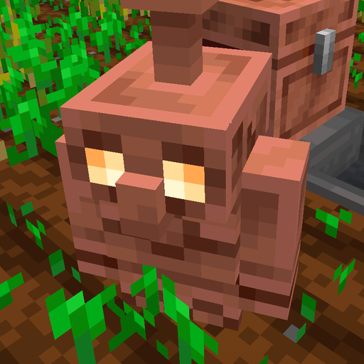
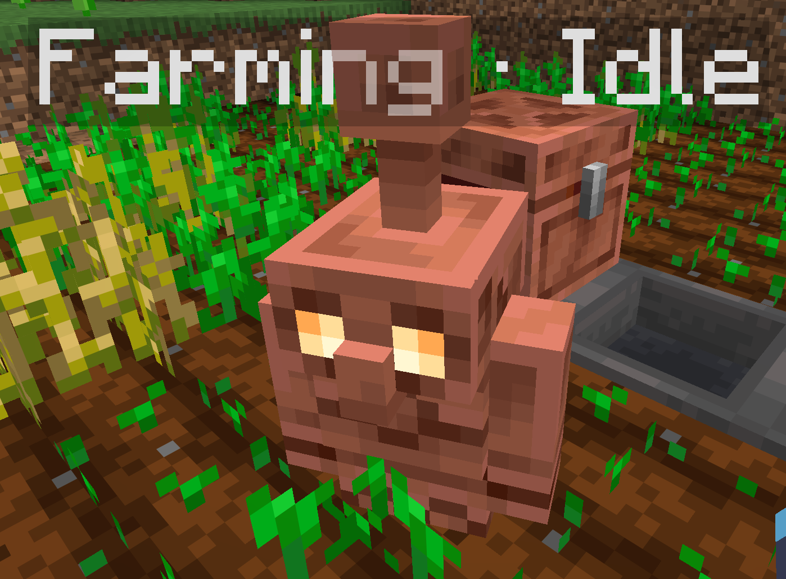

<p align="center"></p>

# Smarter Golems

Give your copper golems real jobs. Sneak + right-click a copper golem to make it a **farmer**, a **woodcutter** or a **collector**, or teach it a **custom** job by showing it what to do. It works the area around it and puts what it gathers into a chest.

Built for **Minecraft 26.3** with **Fabric**.



## How to use

1. Build a copper golem the vanilla way: a carved pumpkin on a copper block.
2. Stand it where you want it to work, then **sneak + right-click it with an empty hand**.
3. Pick a task. While the menu is open, particles outline the golem's work area.
   - **Farming** covers a **9x9 area**, the same reach as water hydrating farmland. It's centered on the **nearest chest**, so the classic layout just works: a **waterlogged chest** in the middle of a 9x9 farm. With no chest nearby, it centers on the golem.
   - **Woodcutting, collecting and custom** cover a **15x15 area** centered on where the golem stood.
4. Put a **chest** in or near the area (up to 4 blocks outside it). The golem drops its haul there.

Choose **No task** to give a golem its vanilla behavior back. Anything still in its bag is dropped.

## Tasks

### Farming
- Harvests and replants **wheat, carrots, potatoes, beetroot** and **nether wart**.
- Picks **sweet berries** (the bush stays) and **cocoa beans** (the pod regrows).
- Harvests **pumpkins and melons** grown from a stem. Decorative pumpkins and melons are left alone.
- Cuts **sugar cane, cactus and bamboo**, leaving the bottom block to regrow.
- Plants seeds it carries on empty farmland, and nether wart on empty soul sand.
- **With a hoe:** grows your farm by tilling dirt or grass next to existing farmland, within 4 blocks of water. It tills one block for each seed it carries.
- **With bone meal:** helps growing crops along.

### Woodcutting
- Chops the nearest tree, fells the whole thing (logs and leaves) and replants a matching sapling. In a forest, neighboring trees keep their leaves.
- **With an axe:** chops faster. A better axe means faster chopping.
- **With bone meal:** grows saplings.
- Pushes through natural leaves to reach trunks.
- **Leaves log builds alone.** Something only counts as a tree if all of these are true:
  - it has natural leaves attached (leaves you place yourself don't count)
  - it has no stripped logs
  - its base is at most a 2x2 trunk standing on dirt or grass
- ⚠️ Logs that **touch** a tree count as part of it, so keep log builds out of a woodcutter's area, or at least not touching any trees.

### Collecting
- Picks up items lying on the ground in its area, such as under a mob farm, and puts them in the chest.

### Custom: teach by example
Show the golem a job by doing it yourself: mining a **cobblestone generator**, or running a **clay farm**.

1. Build the farm or generator first. Everything you do while teaching is recorded.
2. Stand the golem near the spot and open its menu. Click **Custom: teach by example**.
3. Do the job once, within the golem's 15x15 area (up to 4 blocks up or down):
   - **Break** blocks it should mine.
   - **Place** blocks it should place.
   - **Right-click with items** it should use: a water bottle on dirt, a bucket at water, bone meal and so on.

   Particles mark each taught spot, and the action bar counts the steps (up to 16). Clicks that change nothing, like opening a chest, aren't recorded.
4. **Sneak + right-click the golem** to finish. This works whatever you're holding. Teaching ends after 5 minutes without a new step.

Each step is tied to one spot and remembers what that spot looked like when you did it. The golem repeats a step whenever the spot looks like that again:
- **Mining:** whenever **the same block** is back. If a spot ends up holding something else (say, obsidian instead of cobblestone), it's left alone. The golem waits next to a generator while it refills.
- **Placing and using items:** whenever the spot is **exactly** as it was. Place dirt where there was air, use the water bottle where there was dirt. The golem uses the item standing where you stood and looking where you looked, so it works like your own click.

So the steps of a cycle happen in the right order by themselves, and **you can teach them in any order**. For a clay farm (dirt on a block above pointed dripstone), you don't have to wait for the mud to dry: put a clay block on the spot before teaching, then break the clay, place dirt and use a water bottle on it. The golem then places dirt, makes mud, waits for the dripstone to turn it into clay, mines the clay and starts over.

- **Items come from the supply chest.** The golem keeps up to 16 of each item it was taught to use (one of each item that doesn't stack, like buckets). Leftovers such as empty bottles go into the chest with its haul.
- **Drops follow vanilla tool rules.** Stone and ores need a **pickaxe** from the supply chest, and the golem won't mine them without one. Dirt, sand or clay can be dug by hand, and a shovel is faster.
- Mining takes as long as it would for a player with the same tool (slower when oxidized).
- Containers, spawners and unbreakable blocks can't be taught to mine.

## Supplies: tools and bone meal

The chest a golem drops items into is also its **supply chest**. Put supplies in it and the golem takes what it needs:

- **Hoe** for farmers, **axe** for woodcutters, the right **pickaxe or shovel** for custom mining. The tool shows in the golem's hand and wears out with use. When it breaks, the golem grabs a new one on its next chest visit.
- **Bone meal:** the golem carries up to 16.

To take a tool back, right-click the golem **without** sneaking, the same as taking any item a copper golem is holding.

## The task menu

- Choose a task, or **No task**.
- See the golem's **tool** and the **9-slot bag** of things it's carrying, and **take its items**.
- See who assigned the task.

**Look at a working golem** to see what it's doing above its head, for example *Farming · Harvesting*.

## Copper and oxidation

Oxidized golems work slower:

| Copper state | Speed |
|---|---|
| Unaffected | 100% |
| Exposed | 85% |
| Weathered | 70% |
| Oxidized | 55% |

**Wax** a golem with honeycomb to keep it at its current speed.

## Multiplayer

- **Owner lock:** the player who assigns a task owns that golem. Other players can open its menu but can't change the task or take its items. Operators can always edit.
- **Install on both server and client.** The server runs the golems. The client shows the task menu and the status display.

## Configuration

`config/smartergolems.json` is created the first time the game starts:

```json
{
  "farmingRadius": 4,
  "areaRadius": 7
}
```

- `farmingRadius`: the distance from the center to the edge of a farm. 4 gives 9x9, matching one water source.
- `areaRadius`: the same for woodcutting and collecting. 7 gives 15x15.

The allowed range for both is 1 to 16. Restart the game or server after changing them. A config file from before 1.1.0 (`farmRadius`) is converted automatically.

## Requirements

- Minecraft **26.3**
- [Fabric Loader](https://fabricmc.net/use/) 0.20.1 or newer
- [Fabric API](https://modrinth.com/mod/fabric-api)
- Java 25

## Building from source

```sh
./gradlew build
```

The mod jar ends up in `build/libs/`. A build also runs the in-game automated tests (Fabric GameTest), which cover farming, woodcutting, build protection, collecting, supplies and the owner lock.

## License

[MIT](LICENSE)
